# Architecture Design Document — AI Knowledge Platform

**Version:** 2.1  
**Date:** 2026-07-29  
**Status:** FINAL DRAFT — Pending Freeze Approval  
**Changelog from v2.0:** [See Section 20](#20-changelog-from-v20)

---

## Table of Contents

1. [Executive Summary](#1-executive-summary)
2. [High-Level System Architecture](#2-high-level-system-architecture)
3. [Component Architecture](#3-component-architecture)
4. [Workspace / Folder / Asset Hierarchy](#4-workspace--folder--asset-hierarchy)
5. [Database Architecture (PostgreSQL)](#5-database-architecture-postgresql)
6. [Milvus Collection Design](#6-milvus-collection-design)
7. [Metadata Design](#7-metadata-design)
8. [Ingestion Pipeline Architecture](#8-ingestion-pipeline-architecture)
9. [CSV/XLSX Ingestion Design](#9-csvxlsx-ingestion-design)
10. [Chunking Architecture](#10-chunking-architecture)
11. [Query Planner Architecture](#11-query-planner-architecture)
12. [Retrieval Architecture](#12-retrieval-architecture)
13. [Sequence Diagrams](#13-sequence-diagrams)
14. [API Design](#14-api-design)
15. [Module Boundaries & Interfaces](#15-module-boundaries--interfaces)
16. [Background Processing & Task Queue Migration](#16-background-processing--task-queue-migration)
17. [Future Extensibility Points](#17-future-extensibility-points)
18. [Scalability Considerations](#18-scalability-considerations)
19. [Architectural Critique & Improvements](#19-architectural-critique--improvements)
20. [Changelog from v2.0](#20-changelog-from-v20)
21. [Architecture Freeze Review](#21-architecture-freeze-review)
22. [Implementation Roadmap](#22-implementation-roadmap)

---

## 1. Executive Summary

This document defines the architecture for evolving the current AI Document RAG project from a flat document-upload-and-search tool into a **general-purpose, modular, multimodal RAG platform**.

### Current State

The existing system is a monolithic single-pipeline application:

```
Upload → Docling → Markdown → Chunking → Embeddings → Milvus → Search
```

It has a flat `documents` table, no concept of workspaces or folders, no structured data support, no query planning, and a single global search scope.

### Target State

A workspace-centric knowledge platform with:

- **Hierarchical knowledge organization** (Workspaces → Folders → Assets)
- **Scoped retrieval** (file, folder, workspace, global)
- **Dual data paths** (unstructured documents via vector search, structured data via SQL)
- **Intelligent query planning** (route queries to the right retrieval strategy)
- **Modular, pluggable services** (swap OCR engines, embedding models, LLM providers)
- **Version tracking** across assets, embeddings, and parsers for future migrations

### Design Principles

| Principle | Rationale |
|---|---|
| **PostgreSQL is source of truth** | All metadata, relationships, content, and state live in Postgres. Milvus is a derived index. |
| **Milvus stores only vectors** | Chunk IDs + embeddings + scope filters. Never primary data. |
| **Local-first processing** | No cloud dependencies for data security. |
| **Modular service boundaries** | Each service has a single responsibility and communicates through defined interfaces. |
| **Pipeline-as-configuration** | Ingestion pipelines are composed of pluggable stages, not hardcoded sequences. |
| **Version everything** | Assets, embeddings, and parsers carry version metadata so migrations never require redesigns. |

---

## 2. High-Level System Architecture

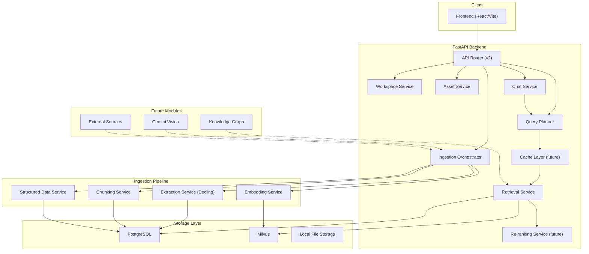

### Key Architectural Decisions

| Decision | Alternative Considered | Why This Choice |
|---|---|---|
| Single FastAPI process | Microservices | Avoids operational complexity for a local-first tool. Microservices add network overhead with no benefit at this scale. |
| PostgreSQL for structured data | SQLite, DuckDB | Postgres supports concurrent access, JSONB, full-text search, and scales to millions of rows. Already deployed. |
| Milvus for vectors only | pgvector | Milvus provides superior ANN performance, dedicated HNSW tuning, and partition-based filtering. pgvector is viable but slower at scale. |
| Background tasks via FastAPI | Celery, Dramatiq | Keeps deployment simple for dev. Explicit migration path to ARQ documented in [Section 16](#16-background-processing--task-queue-migration). |

---

## 3. Component Architecture

### Service Layer

```
app/
├── api/v2/                          # Versioned API routes
│   ├── workspaces.py
│   ├── folders.py
│   ├── assets.py
│   ├── search.py
│   ├── chat.py
│   ├── datasets.py                  # CSV/XLSX endpoints
│   └── health.py
│
├── models/                          # SQLAlchemy ORM models
│   ├── workspace.py
│   ├── folder.py
│   ├── asset.py
│   ├── asset_chunk.py
│   ├── dataset.py
│   ├── dataset_sheet.py
│   ├── chat_session.py
│   ├── chat_message.py
│   └── base.py
│
├── schemas/                         # Pydantic request/response
│   ├── workspace.py
│   ├── folder.py
│   ├── asset.py
│   ├── search.py
│   ├── chat.py
│   └── dataset.py
│
├── services/                        # Business logic
│   ├── workspace_service.py
│   ├── folder_service.py
│   ├── asset_service.py
│   ├── ingestion/
│   │   ├── orchestrator.py          # Pipeline coordinator
│   │   ├── extraction_service.py    # Docling wrapper
│   │   ├── chunking_service.py      # Text splitting
│   │   └── structured_data_service.py  # CSV/XLSX handler
│   ├── embedding_service.py
│   ├── milvus_service.py
│   ├── query_planner.py
│   ├── retrieval_service.py
│   ├── reranking_service.py         # Future: pluggable reranker
│   ├── cache_service.py             # Future: retrieval cache
│   ├── chat_service.py
│   └── storage_service.py
│
├── config.py
├── database.py
├── dependencies.py
└── main.py
```

> [!IMPORTANT]
> The current flat `app/services/document_service.py` (290 lines) that handles upload, extraction, chunking, embedding, indexing, retrieval, listing, and deletion **all in one class** must be decomposed. The new architecture splits this into `AssetService` (CRUD), `IngestionOrchestrator` (pipeline), `RetrievalService` (search), and `ChatService` (LLM interaction).

---

## 4. Workspace / Folder / Asset Hierarchy

### Data Model

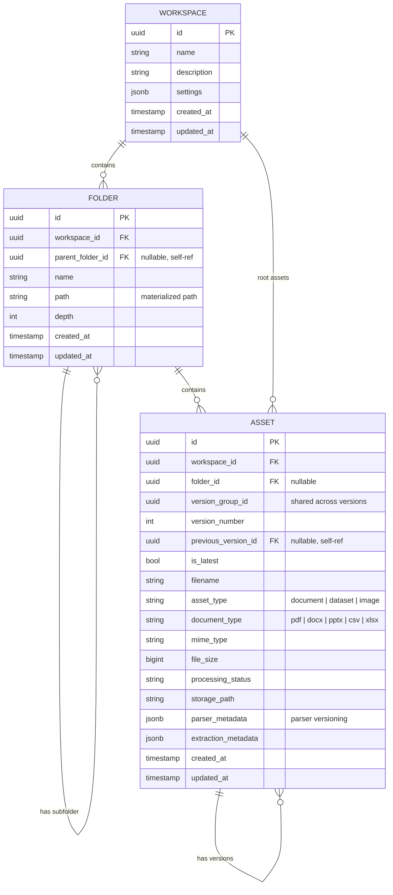

### Materialized Path Strategy for Folders

Each folder stores its full path from root for efficient ancestor/descendant queries:

```
/                          → workspace root
/Semester 6/               → depth 1
/Semester 6/DMBI/          → depth 2
/Semester 6/DMBI/Notes/    → depth 3
```

**Why materialized path over adjacency list?**

| Approach | Find children | Find all descendants | Move subtree |
|---|---|---|---|
| Adjacency list (parent_id) | O(1) query | Recursive CTE | O(1) |
| Materialized path | `WHERE path LIKE '/Sem%'` | `WHERE path LIKE '/Sem%'` | Update all paths in subtree |
| Closure table | Join | Join | Rebuild closure entries |

For our use case, reads (scoped retrieval) vastly outnumber writes (folder moves). Materialized paths give us the fastest read performance with a simple `LIKE` query and no recursive CTEs.

> [!TIP]
> We store **both** `parent_folder_id` (for easy parent navigation) and `path` (for fast descendant queries). This hybrid gives us the best of both worlds.

### Asset Versioning

Assets support explicit versioning through three fields:

- **`version_group_id`**: A UUID shared across all versions of the same logical document. When v1 of "HR Policy.pdf" is uploaded, a new `version_group_id` is generated. When v2 is uploaded, it shares the same `version_group_id`.
- **`version_number`**: Integer starting at 1, monotonically increasing.
- **`previous_version_id`**: Self-referential FK pointing to the prior version. Forms a linked list.
- **`is_latest`**: Boolean flag. Only one version per `version_group_id` has `is_latest=True`.

```
HR Policy (version_group_id: abc-123)
├── v1 (id: 001, previous: null,  is_latest: false)
├── v2 (id: 002, previous: 001,   is_latest: false)
└── v3 (id: 003, previous: 002,   is_latest: true)
```

**Default behavior**: Retrieval and search only operate on `is_latest=True` assets unless the user explicitly requests a specific version. This keeps the search index clean.

**Upload flow for new version**:
1. User uploads to same folder with same filename (or explicitly marks "new version").
2. System detects existing `version_group_id` by matching `workspace_id + folder_id + filename`.
3. Old version's `is_latest` is set to `false`.
4. New asset record created with `is_latest=True`, incremented `version_number`, and `previous_version_id` pointing to old version.
5. Old version's Milvus vectors are deleted. New version is fully re-ingested.

> [!NOTE]
> **Why not keep old vectors?** Old versions retain their `extracted_text` and `asset_chunks` in Postgres for future diffing, but their vectors are removed from Milvus to prevent stale results polluting search. If a user wants to search an old version, they can explicitly scope to it.

---

## 5. Database Architecture (PostgreSQL)

### Complete ER Diagram

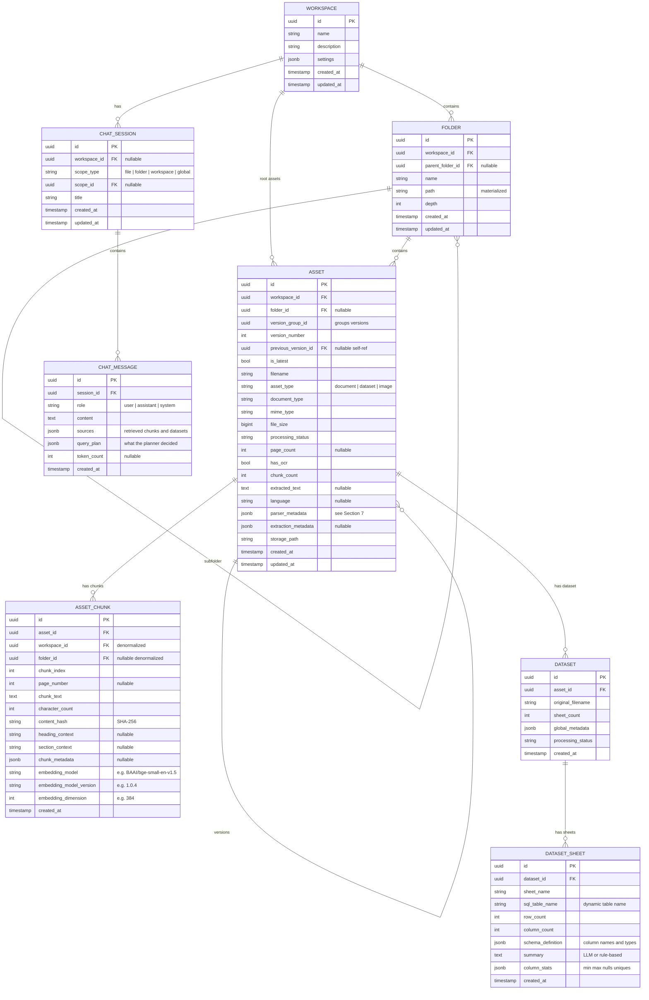

### Key Design Decisions

**Denormalized `workspace_id` and `folder_id` on `ASSET_CHUNK`:**  
Intentional. When searching "all chunks in workspace X", a normalized design would require joining through `ASSET` to get the workspace_id. By denormalizing, Milvus filter expressions can directly use `workspace_id` without a Postgres join, keeping vector search fast.

**`content_hash` on `ASSET_CHUNK`:**  
A SHA-256 hash of the chunk's `chunk_text`. This serves three purposes:
1. **Deduplication**: Before inserting a chunk, check if a chunk with the same hash already exists in the same asset. Skip if duplicate.
2. **Incremental re-indexing**: When a document is re-processed (e.g., after a parser upgrade), compare old chunk hashes with new ones. Only re-embed chunks that changed.
3. **Change detection**: When uploading a new asset version, diff the chunk hashes between v(N) and v(N-1) to identify what actually changed.

**Where `content_hash` is computed:**  
In `ChunkingService`, immediately after splitting. The hash is deterministic: `hashlib.sha256(chunk_text.encode('utf-8')).hexdigest()`. It travels with the `EnrichedChunkData` transfer object from chunking through embedding to storage.

**How `content_hash` is used in the pipeline:**

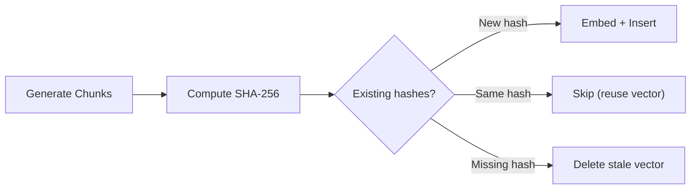

**Embedding versioning on `ASSET_CHUNK`:**  
Each chunk records which model produced its embedding. This enables:
- **Selective re-indexing**: "Re-embed all chunks still on `bge-small-en-v1.5` with `bge-large-en-v1.5`"
- **Mixed-model detection**: The system can warn if a workspace contains chunks from different embedding models (which would make similarity scores incomparable)
- **Audit trail**: Know exactly which model version produced each vector

**`CHAT_SESSION.scope_type` + `scope_id`:**  
Polymorphic reference allows a chat session to be scoped to any level of the hierarchy. The `scope_type` enum tells the Query Planner how to build its filter expression.

### Indexes

```sql
-- Folder hierarchy
CREATE INDEX idx_folder_workspace ON folders(workspace_id);
CREATE INDEX idx_folder_parent ON folders(parent_folder_id);
CREATE INDEX idx_folder_path ON folders(path text_pattern_ops);

-- Asset lookups
CREATE INDEX idx_asset_workspace ON assets(workspace_id);
CREATE INDEX idx_asset_folder ON assets(folder_id);
CREATE INDEX idx_asset_status ON assets(processing_status);
CREATE INDEX idx_asset_version_group ON assets(version_group_id);
CREATE UNIQUE INDEX idx_asset_latest ON assets(version_group_id) WHERE is_latest = true;

-- Chunk retrieval
CREATE INDEX idx_chunk_asset ON asset_chunks(asset_id);
CREATE INDEX idx_chunk_workspace ON asset_chunks(workspace_id);
CREATE INDEX idx_chunk_folder ON asset_chunks(folder_id);
CREATE INDEX idx_chunk_content_hash ON asset_chunks(content_hash);
CREATE INDEX idx_chunk_embedding_model ON asset_chunks(embedding_model);

-- Chat
CREATE INDEX idx_chat_session_workspace ON chat_sessions(workspace_id);
CREATE INDEX idx_chat_message_session ON chat_messages(session_id);
```

> [!TIP]
> The partial unique index `idx_asset_latest` guarantees at the database level that only one version per `version_group_id` can have `is_latest=true`. This is a constraint, not just an index — it prevents application bugs from creating two "latest" versions.

---

## 6. Milvus Collection Design

### Collection: `knowledge_vectors`

Replaces the current `document_vectors` collection with scope-aware fields.

| Field | Type | Description |
|---|---|---|
| `chunk_id` | VARCHAR(36), PK | Matches `asset_chunks.id` in Postgres |
| `workspace_id` | VARCHAR(36) | For workspace-scoped filtering |
| `folder_id` | VARCHAR(36) | For folder-scoped filtering (`""` if root) |
| `asset_id` | VARCHAR(36) | For file-scoped filtering |
| `vector` | FLOAT_VECTOR(384) | Embedding from current model |

### Partition Strategy

Milvus partitions by `workspace_id`. Each workspace gets its own partition:
- **Workspace-scoped search**: Search only one partition
- **Folder-scoped search**: Search one partition + filter `folder_id`
- **File-scoped search**: Search one partition + filter `asset_id`
- **Global search**: Search all partitions

### Index Configuration

```python
index_params = {
    "metric_type": "COSINE",
    "index_type": "HNSW",
    "params": {"M": 16, "efConstruction": 128},
}
```

### Embedding Model Migration Strategy

When the embedding model changes (e.g., BGE-small → BGE-large):

1. **Detection**: Query `SELECT DISTINCT embedding_model FROM asset_chunks` to find chunks on the old model.
2. **Re-indexing**: A migration script iterates over stale chunks, re-embeds them with the new model, and updates both Postgres (`embedding_model`, `embedding_model_version`, `embedding_dimension`) and Milvus (delete old vector, insert new vector).
3. **Dimension change**: If the new model has a different dimension (e.g., 384 → 1024), a new Milvus collection is created (`knowledge_vectors_v2`), old data is migrated, and the old collection is dropped. The collection name is stored in config, not hardcoded.
4. **Safety**: The migration runs workspace-by-workspace so that a partial failure doesn't corrupt the entire index.

> [!NOTE]
> Milvus itself does **not** need to store model metadata. The chunk's `chunk_id` is the foreign key back to Postgres where all versioning metadata lives. Milvus remains a pure vector index.

---

## 7. Metadata Design

### Parser Metadata (on `ASSET.parser_metadata`)

Every processed asset records exactly how it was parsed:

```json
{
    "parser_name": "docling",
    "parser_version": "2.115.0",
    "ocr_engine": "rapidocr",
    "ocr_version": "1.4.4",
    "ocr_backend": "torch",
    "extraction_timestamp": "2026-07-29T13:00:00Z",
    "processing_time_ms": 4500
}
```

**Use cases:**
- **Selective reprocessing**: "Reprocess all assets parsed by Docling < 2.120.0" — query `parser_metadata->>'parser_version'`
- **Quality tracking**: Correlate parser version with extraction quality metrics over time
- **Debugging**: When extraction looks wrong, check which parser version produced it

### Extraction Metadata (on `ASSET.extraction_metadata`)

Parser-specific output statistics:

```json
{
    "page_count": 12,
    "table_count": 3,
    "image_count": 5,
    "has_ocr": true,
    "language_detected": "en",
    "export_format": "markdown"
}
```

### Common Asset Metadata (queryable fields on `ASSET`)

| Field | Source | Queryable |
|---|---|---|
| `workspace_id` | Upload context | Direct FK |
| `folder_id` | Upload context | Direct FK |
| `filename` | Upload | Column |
| `asset_type` | Detection | Column |
| `document_type` | Extension | Column |
| `mime_type` | Upload | Column |
| `language` | Detection | Column |
| `file_size` | Upload | Column |
| `version_number` | System | Column |
| `is_latest` | System | Column |
| `processing_status` | Pipeline | Column |
| `parser_metadata` | Pipeline | JSONB |
| `extraction_metadata` | Pipeline | JSONB |

### Chunk-Level Metadata (on `ASSET_CHUNK`)

| Field | Description | Type |
|---|---|---|
| `heading_context` | `"Ch2 > 2.1 Preprocessing > Binning"` | VARCHAR |
| `section_context` | `"Data Preprocessing"` | VARCHAR |
| `content_hash` | SHA-256 of `chunk_text` | VARCHAR(64) |
| `embedding_model` | `"BAAI/bge-small-en-v1.5"` | VARCHAR |
| `embedding_model_version` | `"1.0.4"` | VARCHAR |
| `embedding_dimension` | `384` | INTEGER |
| `chunk_metadata` | Additional structured data | JSONB |

---

## 8. Ingestion Pipeline Architecture

### Pipeline Overview

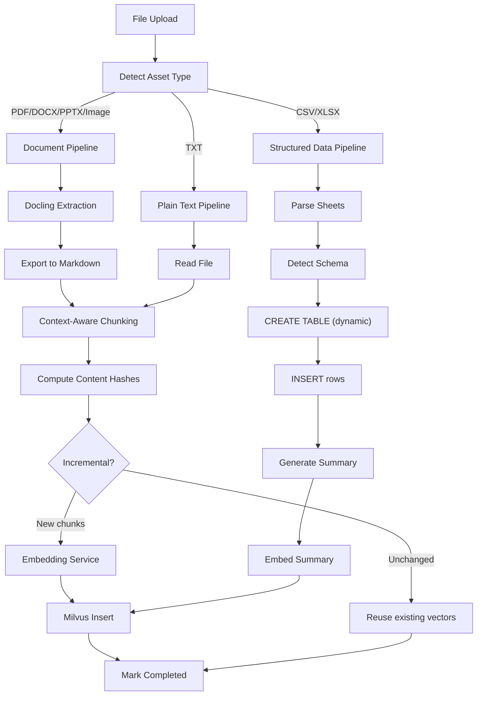

### Ingestion Orchestrator

The `IngestionOrchestrator` replaces the current monolithic `_process_document_pipeline` method. It determines which pipeline to use based on asset type and coordinates the stages.

```python
class IngestionOrchestrator:
    """Coordinates the ingestion pipeline for any asset type.
    
    This class is designed to be task-queue agnostic. The `ingest` method
    accepts an asset_id and a database session factory (not a session).
    This allows it to be called from FastAPI BackgroundTasks today or
    from an ARQ/Celery worker tomorrow without any code changes.
    """
    
    def __init__(
        self,
        extraction: ExtractionService,
        structured_data: StructuredDataService,
        chunking: ChunkingService,
        embedding: EmbeddingService,
        milvus: MilvusService,
    ): ...

    def ingest(self, asset_id: str, db_factory: Callable[[], Session]) -> None:
        """Route to the correct pipeline based on asset_type.
        
        Args:
            asset_id: UUID of the asset to ingest.
            db_factory: Callable that returns a new database session.
                        This decouples the orchestrator from session lifecycle.
        """
        db = db_factory()
        try:
            asset = db.query(Asset).filter(Asset.id == asset_id).first()
            if asset.asset_type == "dataset":
                self._ingest_dataset(asset, db)
            elif asset.asset_type == "document":
                self._ingest_document(asset, db)
        finally:
            db.close()
```

### Per-Format Extraction Details

| Format | Backend | Pipeline | OCR | Output |
|---|---|---|---|---|
| PDF | DoclingParseDocumentBackend | StandardPdfPipeline | RapidOCR (on image regions) | Markdown |
| DOCX | MsWordBackend | SimplePipeline | N/A (native text) | Markdown |
| PPTX | MsPowerPointBackend | SimplePipeline | N/A (native text) | Markdown |
| Images (PNG/JPG/TIFF) | ImageDocumentBackend | StandardPdfPipeline | RapidOCR (entire image) | Markdown |
| TXT | Native Python | N/A | N/A | Raw text |
| CSV | pandas | N/A | N/A | SQL table + summary |
| XLSX | openpyxl + pandas | N/A | N/A | SQL tables + summaries |

---

## 9. CSV/XLSX Ingestion Design

### Architecture

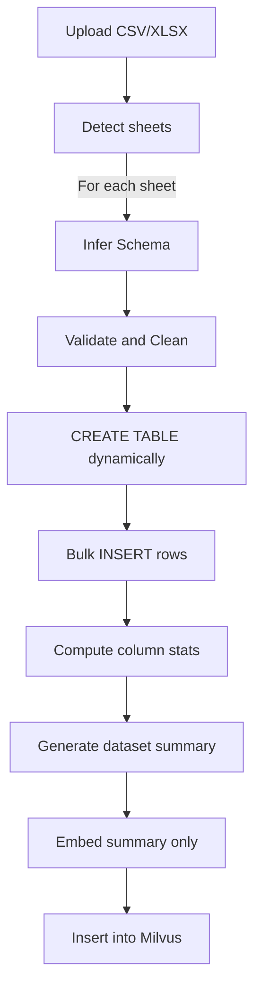

### Dynamic SQL Table Naming

Each sheet creates a PostgreSQL table with a deterministic name:

```
ds_{asset_id_short}_{sanitized_sheet_name}
```

Example: `ds_7e9b22a6_revenue_2024`

### Schema Detection

```python
class StructuredDataService:
    def _infer_schema(self, df: pd.DataFrame) -> dict:
        """Map pandas dtypes to PostgreSQL types."""
        type_map = {
            "int64": "BIGINT",
            "float64": "DOUBLE PRECISION",
            "object": "TEXT",
            "bool": "BOOLEAN",
            "datetime64[ns]": "TIMESTAMP",
        }
        return {
            col: type_map.get(str(df[col].dtype), "TEXT")
            for col in df.columns
        }
```

### What Gets Embedded

**NOT** every row. Instead:

1. **Dataset summary**: "This dataset contains 15,000 rows of quarterly revenue data across 25 columns including region, product_line, revenue, cost, margin. Date range: Q1 2024 – Q4 2024."
2. **Column descriptions**: "Column 'revenue' is DOUBLE PRECISION, range 1,200 to 985,000, 0 nulls."
3. **Sheet name + context**: "Sheet 'Revenue by Region' from file 'financial_report.xlsx' in workspace 'Finance'."

> [!TIP]
> **Small table exception**: If a sheet has fewer than 500 rows and at least one text-heavy column (average cell length > 50 characters), embed each row individually. This enables semantic lookup on reference tables (product catalogs, policy lists) that SQL alone cannot match.

### SQL Query Strategy

| Query Complexity | Strategy | Example |
|---|---|---|
| Simple aggregation | Template | "What is the average revenue?" → `SELECT AVG(revenue) FROM ds_xxx` |
| Filter + group | Template | "Revenue by region in Q3" → `SELECT region, SUM(revenue) ...` |
| Complex NL query | LLM-generated SQL | "Show me top 5 products with declining margins" |

> [!WARNING]
> **All LLM-generated SQL MUST be validated before execution.** Validation includes:
> - Whitelist: Only SELECT statements allowed (no INSERT/UPDATE/DELETE/DROP)
> - Table whitelist: Only `ds_*` prefixed tables
> - Row limit: Auto-append `LIMIT 1000` if missing
> - Timeout: 5-second query timeout

---

## 10. Chunking Architecture

### Context-Preserving Chunks

Each chunk carries its structural context and traceability metadata:

```python
@dataclasses.dataclass
class EnrichedChunkData:
    chunk_index: int
    page_number: int | None
    chunk_text: str
    character_count: int
    content_hash: str              # SHA-256 of chunk_text
    
    # Structural context
    heading_context: str | None     # "Ch2 > 2.1 Preprocessing > Binning"
    section_context: str | None     # "Data Preprocessing"
    element_types: list[str]        # ["paragraph", "table", "list"]
    
    # Scope references (denormalized for Milvus)
    workspace_id: str
    folder_id: str | None
    asset_id: str
    
    # Embedding traceability
    embedding_model: str            # "BAAI/bge-small-en-v1.5"
    embedding_model_version: str    # "1.0.4"
    embedding_dimension: int        # 384
```

### Chunking Strategy

Since Docling outputs Markdown, we leverage Markdown structure:

```python
class MarkdownAwareChunker:
    """Chunks Markdown while preserving heading hierarchy."""
    
    def chunk(self, markdown: str, ...) -> list[EnrichedChunkData]:
        # 1. Parse heading hierarchy from Markdown
        # 2. Split on ## boundaries first (section-level)
        # 3. Sub-split large sections with RecursiveCharacterTextSplitter
        # 4. Attach heading_context to every chunk
        # 5. Preserve tables as single chunks (never split a table)
        # 6. Compute content_hash for every chunk
```

> [!IMPORTANT]
> **Never split a Markdown table across chunks.** If a table exceeds `chunk_size`, it becomes its own chunk regardless of size. Tables lose all meaning when split.

---

## 11. Query Planner Architecture

### Overview

The Query Planner sits between the user's natural language query and the retrieval backends. It classifies intent, assigns a confidence score, selects retrieval strategies, and resolves scope.

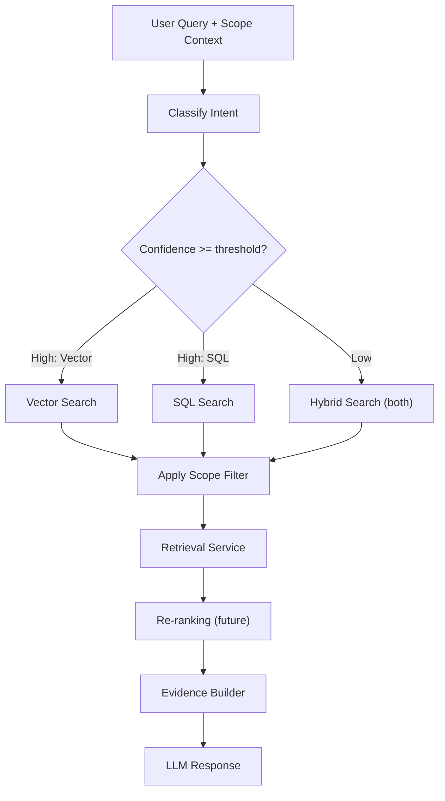

### Query Classification

```python
class QueryIntent(str, Enum):
    FACTUAL = "factual"        # "What is binning in data mining?"
    DATA = "data"              # "What is the average revenue?"
    COMPARATIVE = "comparative" # "Compare Q1 and Q2 margins"
    NAVIGATIONAL = "navigational"  # "Show me the HR documents"
    HYBRID = "hybrid"          # "Explain the revenue trend"

class QueryPlan:
    intent: QueryIntent
    confidence: float               # 0.0 to 1.0
    strategies: list[RetrievalStrategy]
    scope: RetrievalScope
    filters: dict
    sql_query: str | None
    reranking_needed: bool
```

### Confidence Scoring

**Phase 1: Rule-based scoring**

```python
class QueryPlanner:
    def _compute_confidence(self, query: str, intent: QueryIntent) -> float:
        """Rule-based confidence scoring.
        
        The score represents how certain the planner is that the
        classified intent is correct. Low confidence triggers
        hybrid retrieval as a safety net.
        """
        score = 0.5  # base confidence
        
        if intent == QueryIntent.DATA:
            # Strong data signals boost confidence
            data_keywords = {"average", "sum", "count", "total", "max", "min",
                           "how many", "percentage", "revenue", "cost"}
            matches = sum(1 for kw in data_keywords if kw in query.lower())
            score += min(matches * 0.15, 0.45)
            
        elif intent == QueryIntent.FACTUAL:
            # Question words + no numeric intent = factual
            question_words = {"what", "how", "why", "explain", "describe", "define"}
            if any(query.lower().startswith(w) for w in question_words):
                score += 0.3
            if not any(char.isdigit() for char in query):
                score += 0.1
                
        # Ambiguity signals reduce confidence
        if len(query.split()) < 3:
            score -= 0.2  # Very short queries are ambiguous
        if "?" not in query and not query.endswith("."):
            score -= 0.1  # Not clearly a question
            
        return max(0.0, min(1.0, score))
```

**Routing logic:**

| Confidence | Action |
|---|---|
| ≥ 0.75 | Use the single classified strategy (vector OR sql) |
| 0.5 – 0.74 | Use classified strategy + fallback to secondary |
| < 0.5 | Hybrid search (both vector AND sql), merge results |

**Phase 2 (future):** Replace rule-based classifier with a fine-tuned small model or LLM-based classifier that outputs a structured `QueryPlan` JSON. The confidence scoring interface remains identical.

### Scope Resolution

```python
class RetrievalScope:
    scope_type: Literal["file", "folder", "workspace", "global"]
    workspace_id: str | None
    folder_id: str | None
    asset_id: str | None
    
    def to_milvus_expr(self) -> str:
        """Convert scope to a Milvus filter expression."""
        if self.scope_type == "file":
            return f'asset_id == "{self.asset_id}"'
        elif self.scope_type == "folder":
            return f'folder_id == "{self.folder_id}"'
        elif self.scope_type == "workspace":
            return f'workspace_id == "{self.workspace_id}"'
        else:
            return ""
```

---

## 12. Retrieval Architecture

### Full Retrieval Pipeline

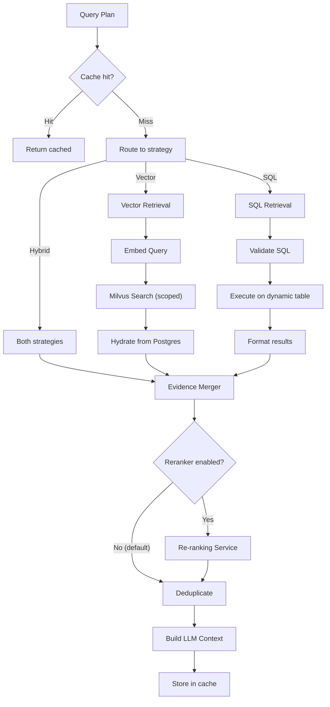

### Re-ranking Layer (Future-Ready)

The re-ranking service sits between retrieval and context assembly. It is **disabled by default** and can be enabled via configuration.

```python
class RerankingInterface(Protocol):
    """Interface for pluggable rerankers."""
    def rerank(
        self, query: str, results: list[RetrievalResult], top_k: int
    ) -> list[RetrievalResult]: ...

class NoOpReranker:
    """Default pass-through reranker (no reranking)."""
    def rerank(self, query, results, top_k):
        return results[:top_k]

class CrossEncoderReranker:
    """Future: BGE/Jina/Cohere reranker."""
    def __init__(self, model_name: str): ...
    def rerank(self, query, results, top_k):
        # Score each (query, chunk_text) pair with cross-encoder
        # Sort by cross-encoder score
        # Return top_k
        ...
```

**Integration point**: `RetrievalService` holds a `reranker: RerankingInterface` dependency. By default it receives `NoOpReranker`. Swapping in a cross-encoder reranker requires only a config change and adding the model dependency.

### Retrieval Cache Layer (Future-Ready)

The cache layer is a thin abstraction that wraps retrieval calls. It is designed but **not implemented in Phase 1**.

```python
class CacheInterface(Protocol):
    """Interface for pluggable cache backends."""
    def get(self, key: str) -> Any | None: ...
    def set(self, key: str, value: Any, ttl_seconds: int) -> None: ...
    def invalidate(self, pattern: str) -> None: ...

class NoOpCache:
    """Default: no caching."""
    def get(self, key): return None
    def set(self, key, value, ttl): pass
    def invalidate(self, pattern): pass

class InMemoryCache:
    """Future: LRU cache for development."""
    ...

class RedisCache:
    """Future: Redis cache for production."""
    ...
```

**What gets cached and cache key strategy:**

| Cacheable | Cache Key | TTL | Invalidation |
|---|---|---|---|
| Query embeddings | `emb:{hash(query)}:{model_name}` | 1 hour | Model change |
| Vector search results | `vs:{hash(query)}:{scope}:{top_k}` | 5 min | Asset ingestion in scope |
| SQL results | `sql:{hash(sql_query)}` | 5 min | Dataset update |
| LLM responses | `llm:{hash(query)}:{hash(context)}` | 15 min | Context change |

**Invalidation**: When a new asset is ingested or deleted in a workspace, all cache entries matching that `workspace_id` in their scope are invalidated. This ensures stale results are never served.

**Integration point**: `RetrievalService` holds a `cache: CacheInterface` dependency. Default is `NoOpCache`.

---

## 13. Sequence Diagrams

### Upload & Ingestion (Document)

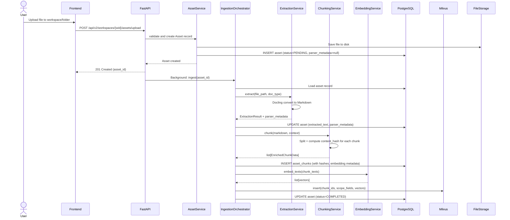

### Query Processing

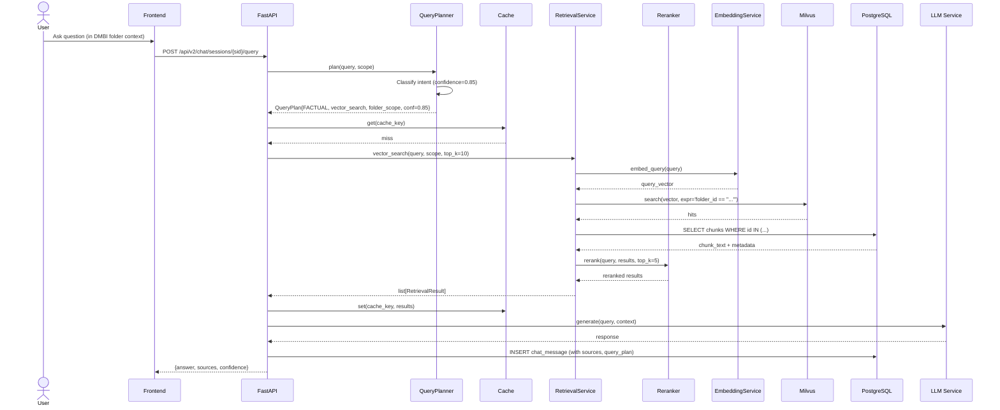

---

## 14. API Design

### API v2 Endpoints

#### Workspaces

| Method | Path | Description |
|---|---|---|
| POST | `/api/v2/workspaces` | Create workspace |
| GET | `/api/v2/workspaces` | List workspaces |
| GET | `/api/v2/workspaces/{id}` | Get workspace details + stats |
| PATCH | `/api/v2/workspaces/{id}` | Update workspace |
| DELETE | `/api/v2/workspaces/{id}` | Delete workspace (cascade) |

#### Folders

| Method | Path | Description |
|---|---|---|
| POST | `/api/v2/workspaces/{wid}/folders` | Create folder |
| GET | `/api/v2/workspaces/{wid}/folders` | List folders (flat or tree) |
| GET | `/api/v2/workspaces/{wid}/folders/{fid}` | Get folder + contents |
| GET | `/api/v2/workspaces/{wid}/folders/{fid}/tree` | Get full subtree |
| PATCH | `/api/v2/workspaces/{wid}/folders/{fid}` | Rename / move folder |
| DELETE | `/api/v2/workspaces/{wid}/folders/{fid}` | Delete folder (cascade) |

#### Assets

| Method | Path | Description |
|---|---|---|
| POST | `/api/v2/workspaces/{wid}/assets/upload` | Upload file (auto-detect version) |
| GET | `/api/v2/workspaces/{wid}/assets` | List assets (filterable by folder) |
| GET | `/api/v2/assets/{id}` | Get asset detail |
| GET | `/api/v2/assets/{id}/chunks` | Get chunks |
| GET | `/api/v2/assets/{id}/versions` | List all versions |
| DELETE | `/api/v2/assets/{id}` | Delete asset (or specific version) |
| POST | `/api/v2/assets/{id}/move` | Move to different folder |
| POST | `/api/v2/assets/{id}/reprocess` | Re-run ingestion pipeline |

#### Search & Chat

| Method | Path | Description |
|---|---|---|
| POST | `/api/v2/search` | Semantic search (scoped) |
| POST | `/api/v2/chat/sessions` | Create chat session |
| GET | `/api/v2/chat/sessions` | List sessions |
| POST | `/api/v2/chat/sessions/{sid}/query` | Ask question |
| GET | `/api/v2/chat/sessions/{sid}/messages` | Get history |
| DELETE | `/api/v2/chat/sessions/{sid}` | Delete session |

#### Datasets

| Method | Path | Description |
|---|---|---|
| GET | `/api/v2/datasets/{id}` | Get dataset metadata |
| GET | `/api/v2/datasets/{id}/sheets` | List sheets |
| GET | `/api/v2/datasets/{id}/sheets/{sid}/preview` | Preview rows (paginated) |
| POST | `/api/v2/datasets/{id}/sheets/{sid}/query` | Execute validated SQL |

#### System

| Method | Path | Description |
|---|---|---|
| GET | `/api/v2/health` | Health check (all services) |
| GET | `/api/v2/system/embedding-status` | Current embedding model + chunk counts per model |
| POST | `/api/v2/system/reindex` | Trigger re-indexing (admin) |

### API Versioning Strategy

The current v1 API continues to work unchanged during migration. The v2 API is the new workspace-aware surface. Once v2 is stable, v1 is deprecated with a 2-release sunset period.

---

## 15. Module Boundaries & Interfaces

### Interface Contracts

```python
# --- Extraction Interface ---
class ExtractionInterface(Protocol):
    def extract(self, file_path: str, document_type: str) -> ExtractionResult: ...

# --- Chunking Interface ---
class ChunkingInterface(Protocol):
    def chunk(self, text: str, context: ChunkContext) -> list[EnrichedChunkData]: ...

# --- Embedding Interface ---
class EmbeddingInterface(Protocol):
    def embed_texts(self, texts: list[str]) -> list[list[float]]: ...
    def embed_query(self, query: str) -> list[float]: ...
    def model_name(self) -> str: ...
    def model_version(self) -> str: ...
    def dimension(self) -> int: ...

# --- Vector Store Interface ---
class VectorStoreInterface(Protocol):
    def insert(self, entries: list[VectorEntry]) -> None: ...
    def search(self, vector: list[float], top_k: int, expr: str) -> list[VectorHit]: ...
    def delete(self, expr: str) -> None: ...

# --- Reranking Interface ---
class RerankingInterface(Protocol):
    def rerank(self, query: str, results: list[RetrievalResult], top_k: int) -> list[RetrievalResult]: ...

# --- Cache Interface ---
class CacheInterface(Protocol):
    def get(self, key: str) -> Any | None: ...
    def set(self, key: str, value: Any, ttl_seconds: int) -> None: ...
    def invalidate(self, pattern: str) -> None: ...

# --- Structured Data Interface ---
class StructuredDataInterface(Protocol):
    def ingest(self, file_path: str, asset: Asset, db: Session) -> DatasetResult: ...
    def execute_query(self, sql: str, db: Session) -> SQLResult: ...

# --- LLM Interface ---
class LLMInterface(Protocol):
    def generate(self, prompt: str, context: str, **kwargs) -> LLMResponse: ...
```

### Dependency Graph

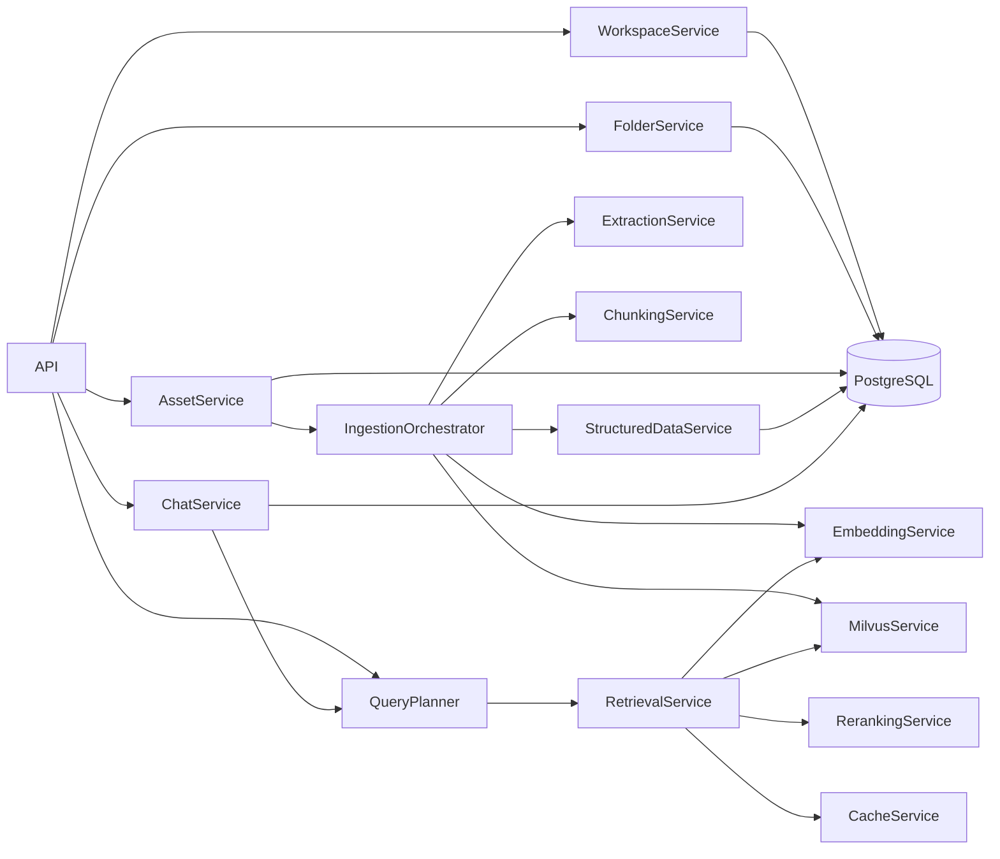

> [!IMPORTANT]
> **No service should depend on another service at the same level.** `AssetService` depends on `IngestionOrchestrator`, but `IngestionOrchestrator` never calls back into `AssetService`. This prevents circular dependencies.

---

## 16. Background Processing & Task Queue Migration

### Current Strategy: FastAPI BackgroundTasks

For development simplicity, ingestion runs via FastAPI's built-in `BackgroundTasks`. This is adequate for single-user local development.

**Known limitations:**
- Tasks run in the same process as the API server
- No retry logic on failure
- No task persistence across server restarts
- No concurrency control (multiple uploads can starve CPU)
- No visibility into running/queued tasks

### Production Migration Path: ARQ

**Why ARQ over Celery/Dramatiq:**

| Feature | Celery | Dramatiq | ARQ |
|---|---|---|---|
| Broker | Redis/RabbitMQ | Redis/RabbitMQ | Redis |
| Async native | No | No | Yes (asyncio) |
| Complexity | High | Medium | Low |
| Dependencies | Many | Moderate | Minimal (just Redis) |
| Python typing | Weak | Moderate | Strong |

ARQ is recommended because it's async-native (matches FastAPI), has minimal dependencies, and supports job retries, timeouts, and health checks out of the box.

### Migration Design

The `IngestionOrchestrator` is designed to be task-queue agnostic:

```python
# --- Phase 1: FastAPI BackgroundTasks ---
@router.post("/upload")
def upload(background_tasks: BackgroundTasks, ...):
    asset = asset_service.create(...)
    background_tasks.add_task(
        ingestion_orchestrator.ingest,
        asset_id=str(asset.id),
        db_factory=SessionLocal,
    )

# --- Phase 2: ARQ Worker (drop-in replacement) ---
async def ingest_task(ctx, asset_id: str):
    orchestrator = ctx["orchestrator"]
    orchestrator.ingest(asset_id=asset_id, db_factory=SessionLocal)

@router.post("/upload")
async def upload(...):
    asset = asset_service.create(...)
    await arq_pool.enqueue_job("ingest_task", str(asset.id))
```

**Key design constraint**: The orchestrator accepts `db_factory: Callable` instead of `db: Session`. This ensures the orchestrator creates its own session, which works identically whether called from an in-process background task or a separate worker process.

### Dead Letter Queue

Failed ingestion tasks should be recorded for debugging:

```sql
CREATE TABLE failed_tasks (
    id UUID PRIMARY KEY DEFAULT gen_random_uuid(),
    asset_id UUID REFERENCES assets(id),
    error_type VARCHAR(200),
    error_message TEXT,
    traceback TEXT,
    retry_count INT DEFAULT 0,
    max_retries INT DEFAULT 3,
    created_at TIMESTAMP DEFAULT NOW()
);
```

---

## 17. Future Extensibility Points

| Future Module | Integration Point | How It Plugs In |
|---|---|---|
| **Gemini Vision** | `ExtractionService` post-processing | After Docling extracts, pass `PictureItem` images to Gemini for diagram understanding. Inject returned text as additional chunks. |
| **Knowledge Graph** | `RetrievalService` | Add a `graph_search` strategy to the Query Planner. Neo4j or NetworkX stores entity relationships extracted during ingestion. |
| **External Sources** | `IngestionOrchestrator` | New `SourceAdapter` classes that fetch content and convert to the same `ExtractionResult` format. |
| **Different Embedding Models** | `EmbeddingService` | `EmbeddingInterface` protocol. Swap model by changing config. Re-index via `embedding_model` column on chunks. |
| **Different LLM Providers** | `ChatService` | `LLMInterface` protocol. Config-driven provider selection (Ollama, vLLM, OpenAI-compatible). |
| **Multi-tenancy** | `Workspace` model | Add `user_id` FK to `Workspace`. All queries filter by user. |
| **Permissions** | Middleware + `Workspace`/`Folder` | RBAC table linking users to workspaces/folders with role (viewer/editor/admin). |
| **Re-ranking** | `RetrievalService` | Swap `NoOpReranker` for `CrossEncoderReranker` via config. |
| **Caching** | `RetrievalService` | Swap `NoOpCache` for `RedisCache` via config. |
| **Handwritten OCR** | `ExtractionService` | Integrate specialized OCR models (like PaddleOCR, Tesseract, or multimodal LLMs) to improve text extraction quality specifically for handwritten notes. |

---

## 18. Scalability Considerations

### Current Bottlenecks

| Component | Current Limit | Mitigation |
|---|---|---|
| **Embedding generation** | CPU-only, sequential | Batch processing with GPU acceleration when available |
| **Docling extraction** | CPU-intensive, single-threaded | Background task queue with concurrency limit |
| **Milvus** | Standalone mode | Milvus Lite for dev, Standalone for production |
| **Background tasks** | FastAPI `BackgroundTasks` (in-process) | Migrate to ARQ + Redis (see [Section 16](#16-background-processing--task-queue-migration)) |

### Data Volume Estimates

| Scale | Documents | Chunks | Milvus Vectors | PostgreSQL Size |
|---|---|---|---|---|
| Personal | 100 | 5,000 | 5,000 × 384 ≈ 7 MB | < 100 MB |
| Team | 1,000 | 50,000 | 50,000 × 384 ≈ 73 MB | < 1 GB |
| Enterprise | 10,000 | 500,000 | 500,000 × 384 ≈ 730 MB | < 10 GB |

All comfortably within a single Milvus Standalone instance and single PostgreSQL database.

---

## 19. Architectural Critique & Improvements

### Knowledge Registry Evaluation

**Verdict: Not recommended as a separate entity.**

The proposed Knowledge Registry would contain: Asset ID, Asset Type, Workspace, Folder, Language, Parser, Embedding Model, Processing Status, Metadata, Summary, Tags, Created/Updated timestamps.

Every single one of these fields already exists on the `ASSET` table (or is derivable from `ASSET` + `ASSET_CHUNK`). Creating a separate registry would:

1. **Duplicate data**: Every field is already in `assets` or computable from joins.
2. **Create write amplification**: Every asset update must also update the registry.
3. **Add sync risk**: If the registry and `assets` table drift, which is truth?

**What we do instead**: Create a **database view** that aggregates the catalog information:

```sql
CREATE VIEW knowledge_catalog AS
SELECT
    a.id AS asset_id,
    a.asset_type,
    a.filename,
    a.document_type,
    a.processing_status,
    a.language,
    a.parser_metadata->>'parser_name' AS parser_name,
    a.parser_metadata->>'parser_version' AS parser_version,
    a.version_number,
    a.is_latest,
    a.chunk_count,
    a.file_size,
    a.created_at,
    a.updated_at,
    w.id AS workspace_id,
    w.name AS workspace_name,
    f.id AS folder_id,
    f.path AS folder_path,
    (SELECT DISTINCT embedding_model FROM asset_chunks ac WHERE ac.asset_id = a.id LIMIT 1) AS embedding_model
FROM assets a
JOIN workspaces w ON a.workspace_id = w.id
LEFT JOIN folders f ON a.folder_id = f.id
WHERE a.is_latest = true;
```

This gives us every benefit of a Knowledge Registry (centralized catalog, queryable, filterable) with zero data duplication and zero sync risk. The view is always consistent because it reads directly from the source tables.

### Final Architecture Review (Senior Architect Perspective)

**Hidden coupling checked:**

| Concern | Status | Notes |
|---|---|---|
| Circular dependencies | ✅ Clean | Dependency graph is a DAG. No cycles. |
| Shared mutable state | ✅ Clean | Services are stateless. State lives in Postgres/Milvus. |
| Leaking abstractions | ⚠️ Minor | `MilvusService` returns `(chunk_id, score)` tuples. Should return typed `VectorHit` objects. Fixed in interface contracts. |
| Config coupling | ✅ Clean | All config flows through `Settings`. No hardcoded values. |

**Database normalization checked:**

| Concern | Status | Notes |
|---|---|---|
| Denormalized `workspace_id` on chunks | ✅ Intentional | Documented rationale. Performance-critical for scoped search. |
| `extracted_text` on Asset | ⚠️ Acceptable | Could be large. Consider moving to a separate `asset_content` table if Assets table scans become slow. For now, acceptable since we rarely query this column in list views. |
| `content_hash` on chunks | ✅ Correct | Lives on the chunk, not a separate table. Right place. |

**API design checked:**

| Concern | Status | Notes |
|---|---|---|
| RESTful consistency | ✅ Clean | Resources are nouns, HTTP verbs are correct. |
| Missing endpoints | ⚠️ Added | `POST /assets/{id}/reprocess` for re-ingestion. `GET /system/embedding-status` for model migration visibility. |
| Bulk operations | ⚠️ Consider later | No bulk upload/delete endpoints yet. Add when needed. |

**Retrieval pipeline checked:**

| Concern | Status | Notes |
|---|---|---|
| Single point of failure | ⚠️ Milvus | If Milvus is down, vector search fails. Mitigation: health check + graceful degradation to full-text search in Postgres. |
| Stale cache risk | ✅ Addressed | Cache invalidation on asset ingestion/deletion. |
| Reranker integration | ✅ Clean | Protocol-based. NoOp default. Zero-change swap. |

**Query Planner checked:**

| Concern | Status | Notes |
|---|---|---|
| Misclassification | ✅ Addressed | Low-confidence queries fall back to hybrid search. |
| Confidence score gaming | ⚠️ Minor | Rule-based scoring is simplistic. Adequate for Phase 1. ML-based upgrade path documented. |
| Missing intent types | ✅ Covered | FACTUAL, DATA, COMPARATIVE, NAVIGATIONAL, HYBRID covers known use cases. |

**Unnecessary complexity identified:**

| Feature | Assessment |
|---|---|
| Asset versioning | Worth keeping. The `version_group_id` + `is_latest` pattern is simple (3 columns) and prevents a future database redesign. |
| Embedding versioning | Worth keeping. 3 columns on chunks. Zero overhead now, essential for model migration later. |
| Retrieval cache | Worth keeping as interface only. `NoOpCache` default adds zero overhead. |
| Re-ranking layer | Worth keeping as interface only. `NoOpReranker` default adds zero overhead. |
| Knowledge Registry (separate table) | **Removed.** Replaced with database view. |

---

## 20. Changelog from v2.0

| # | Section | Change | Rationale |
|---|---|---|---|
| 1 | §4, §5 | Added `version_group_id`, `version_number`, `previous_version_id`, `is_latest` to Asset | Asset versioning support |
| 2 | §5, §7 | Added `parser_metadata` JSONB column to Asset | Parser version tracking for reprocessing |
| 3 | §5, §10 | Added `content_hash` (SHA-256) to AssetChunk | Deduplication, incremental re-indexing, change detection |
| 4 | §5, §7 | Added `embedding_model`, `embedding_model_version`, `embedding_dimension` to AssetChunk | Embedding versioning for model migrations |
| 5 | §11 | Added confidence scoring to QueryPlan with rule-based implementation | Retrieval confidence for routing decisions |
| 6 | §12 | Added `RerankingInterface` with `NoOpReranker` default | Future-ready reranking layer |
| 7 | §12 | Added `CacheInterface` with `NoOpCache` default and cache key strategy | Future-ready retrieval cache |
| 8 | §16 | New section: Background Processing & Task Queue Migration | Explicit ARQ migration path from BackgroundTasks |
| 9 | §19 | Evaluated Knowledge Registry — rejected as separate table, implemented as SQL view | Avoids data duplication and sync risk |
| 10 | §5 | Added partial unique index `idx_asset_latest` | Database-level constraint for single latest version |
| 11 | §14 | Added `POST /assets/{id}/reprocess`, `GET /system/embedding-status`, `POST /system/reindex` endpoints | Operational visibility and control |
| 12 | §8 | Updated IngestionOrchestrator to accept `db_factory` instead of `db` | Task-queue agnostic design |
| 13 | §13 | Updated sequence diagrams to include cache, reranker, and confidence | Reflects new pipeline components |
| 14 | §2 | Updated system architecture diagram with Cache and Reranker nodes | Visual completeness |
| 15 | §19 | Full senior architect review with coupling, normalization, API, and pipeline analysis | Final quality gate |

---

## 21. Architecture Freeze Review

### Assessment: **APPROVED FOR IMPLEMENTATION**

After reviewing this architecture from the perspective of a senior AI architect building a production-grade knowledge platform, my assessment is:

**This architecture is mature enough to begin implementation.**

**Strengths:**
- **Clean separation of concerns**: Every service has a single responsibility with defined interfaces.
- **Future-proof without over-engineering**: Versioning (assets, embeddings, parsers) is 3 columns each — trivial cost now, prevents redesigns later. Cache and reranking layers are NoOp interfaces — zero overhead until activated.
- **PostgreSQL as source of truth**: Milvus can always be rebuilt from Postgres. This is the right call for data integrity.
- **Scope-aware retrieval**: The denormalized workspace/folder IDs on chunks + Milvus partitioning gives us O(1) scope filtering.
- **Task-queue migration path**: The `db_factory` pattern on the orchestrator makes the BackgroundTasks → ARQ transition a config change, not a rewrite.

**Remaining risks (acceptable):**
- **Rule-based Query Planner**: Will misclassify edge cases. Hybrid fallback mitigates this. The interface is ready for ML-based upgrade.
- **Milvus SPOF**: If Milvus crashes, search is unavailable. Acceptable for local-first deployment. In production, Milvus cluster mode addresses this.
- **No auth/RBAC yet**: By design. Multi-tenancy is a future milestone. The workspace model is ready for `user_id`.

**What I would NOT approve:**
- Starting implementation without the v1→v2 API migration strategy being clear.
- Implementing the cache or reranker before the core pipeline works end-to-end.
- Building the LLM integration before scoped retrieval is verified.

---

## 22. Implementation Roadmap

### Milestone 1: Foundation — Database & Workspace CRUD *(Week 1–2)*

**Goal**: New database schema live, workspace/folder/asset CRUD working, file upload scoped to workspaces. No retrieval changes yet.

**Development order** (to avoid refactoring):

1. `models/workspace.py`, `models/folder.py` — ORM models first
2. `models/asset.py` — replaces `models/document.py` (with versioning fields)
3. `models/asset_chunk.py` — replaces `models/document_chunk.py` (with hash, embedding metadata)
4. Database migration script — create new tables, migrate existing data to "Default" workspace
5. `services/workspace_service.py`, `services/folder_service.py`
6. `services/asset_service.py` — CRUD only, no ingestion
7. `api/v2/workspaces.py`, `api/v2/folders.py`, `api/v2/assets.py`
8. Keep v1 API running in parallel

**Exit criteria**: Can create workspaces, folders, upload files to specific folders, list/delete them. Old v1 API still works.

### Milestone 2: Ingestion Pipeline Refactor *(Week 3)*

**Goal**: Ingestion pipeline decomposed from `DocumentService` into `IngestionOrchestrator`. Context-preserving chunking. Content hashing. Embedding versioning.

1. `services/ingestion/orchestrator.py` — extracted from `document_service._process_document_pipeline`
2. `services/ingestion/chunking_service.py` — Markdown-aware chunking with heading context
3. Content hash computation in chunking
4. Embedding metadata populated on chunks
5. Parser metadata populated on assets
6. Delete old `document_service.py` pipeline code

**Exit criteria**: Upload a PDF to a workspace folder. It gets extracted, chunked with heading context, hashed, embedded with model metadata, and indexed. All metadata visible in Postgres.

### Milestone 3: Scoped Milvus & Retrieval *(Week 4)*

**Goal**: New Milvus collection with scope fields. Search respects scope.

1. New Milvus collection `knowledge_vectors` with scope fields
2. `services/milvus_service.py` — updated insert/search with scope expressions
3. `services/retrieval_service.py` — scope-filtered search
4. Migrate existing vectors to new collection
5. `api/v2/search.py` — scoped search endpoint
6. Frontend: scope selector in search UI

**Exit criteria**: Search "binning" scoped to DMBI folder returns only DMBI results. Same query at workspace level returns broader results.

### Milestone 4: Structured Data *(Week 5–6)*

**Goal**: CSV/XLSX upload, schema detection, dynamic SQL tables, dataset summaries embedded.

1. `services/ingestion/structured_data_service.py`
2. `models/dataset.py`, `models/dataset_sheet.py`
3. Dynamic table creation + bulk insert
4. Summary generation + embedding
5. SQL execution endpoint with validation
6. `api/v2/datasets.py`

### Milestone 5: Query Planner *(Week 7)*

**Goal**: Intelligent query routing with confidence scoring.

1. `services/query_planner.py` — rule-based classifier
2. Intent classification + confidence scoring
3. Hybrid retrieval fallback
4. Evidence merger

### Milestone 6: Chat & LLM *(Week 8)*

**Goal**: Conversational RAG with history and source attribution.

1. `models/chat_session.py`, `models/chat_message.py`
2. `services/chat_service.py`
3. LLM integration (Ollama or API-compatible)
4. `api/v2/chat.py`
5. Frontend: chat interface

### Milestone 7: Polish & Hardening *(Week 9–10)*

**Goal**: Production-ready quality.

1. Error handling + retry logic
2. Milvus rebuild script
3. `knowledge_catalog` view
4. API documentation
5. Performance benchmarking
6. Frontend polish

> [!IMPORTANT]
> **Start at Milestone 1.** The development order within each milestone is deliberately sequenced to avoid rework. Models before services. Services before API routes. Backend before frontend.
